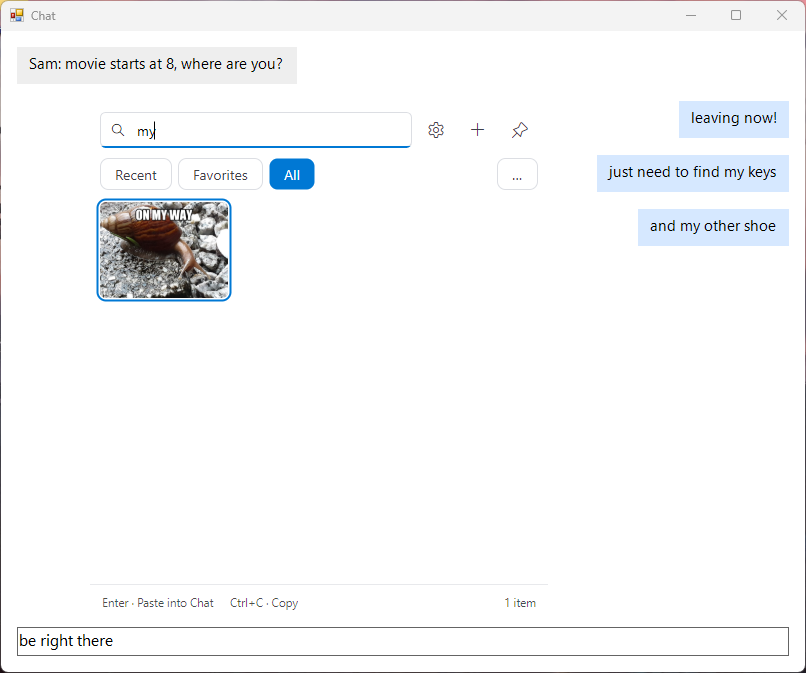
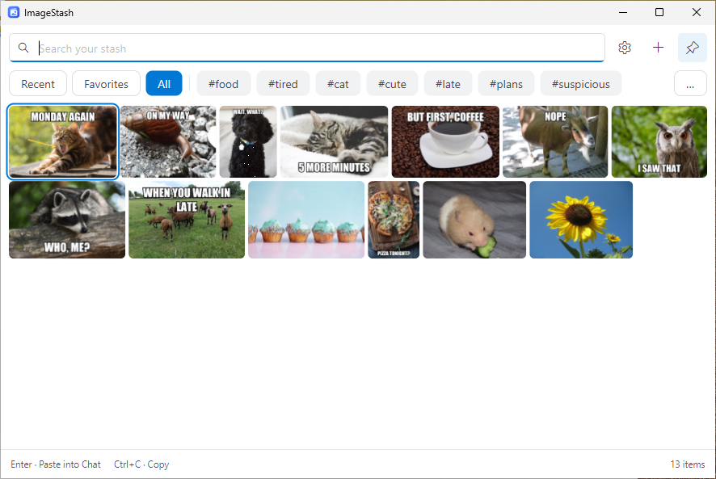
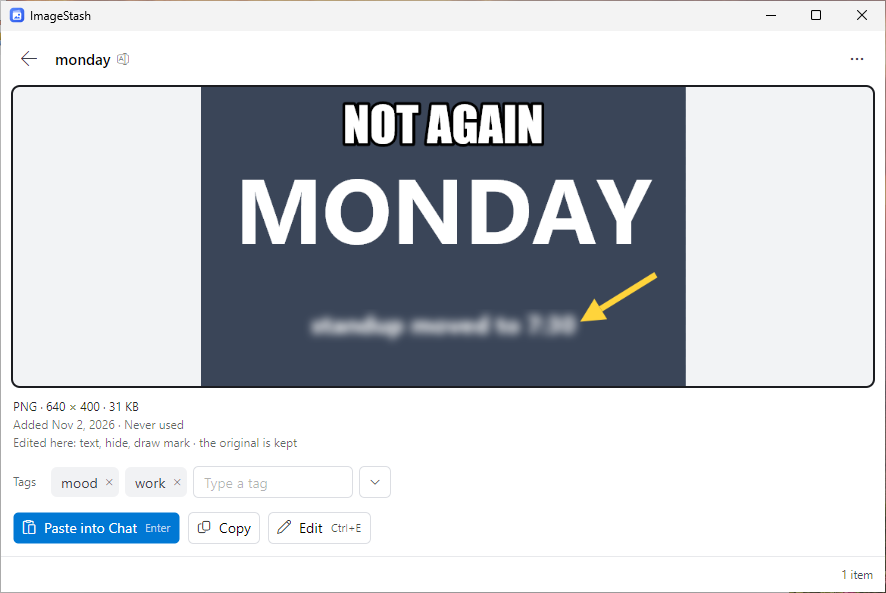
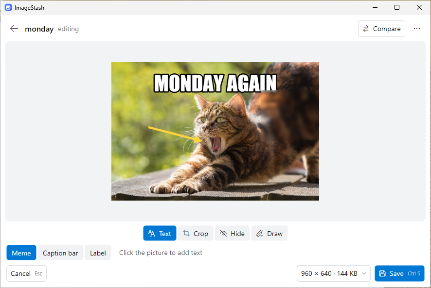

# ImageStash

ImageStash keeps your reaction pictures and GIFs one shortcut away from any chat on Windows 11. While you type a
message, press `Ctrl+Alt+Space`, type two letters of a picture's name or tag and press Enter: the picture is in the
message box you were typing in, and the message is still yours to send. Fill the stash by dropping files on it,
pasting, screenshotting a region or recording a few seconds of the screen; find pictures again by thumbnail, tag,
name, favorite or recent use; caption, crop, trim, blur or draw on them while the original stays untouched.

## Install

On a Windows 11 PC (x64), download one of these from the
[latest release](https://github.com/BrianWeiHaoMa/ImageStash/releases/latest):

- **`ImageStash-<version>-win-x64.msi`**, the installer: it installs ImageStash for you alone, with no administrator
  rights, in `%LOCALAPPDATA%\Programs\ImageStash`, with a Start Menu entry. Uninstalling it (Settings, Apps,
  Installed apps) removes what it installed and keeps your pictures, even ones you moved into that folder.
- **`ImageStash-<version>-win-x64.zip`**: the same program as a folder. Unzip it anywhere you like and run
  `ImageStash.Windows.exe` in it.

`SHA256SUMS.txt` beside them holds the SHA-256 of both.

The download is not signed, so Windows warns before you run it the first time: where it says "Windows protected your
PC", choose **More info**, then **Run anyway**. A PC with Smart App Control turned on blocks it, and is not supported.
Once running, ImageStash sits in the tray (among the hidden icons at first) and starts with Windows; Settings turns
that off.

## Quick start

| Press | What happens |
|---|---|
| `Ctrl+Alt+Space` | In any app, the stash opens beside the text caret, the search box ready. |
| Two letters, then `Enter` | The first match is pasted into the app you came from. Nothing is sent. |
| `Ctrl+PrtScn` | Drag a rectangle: the screenshot is in the stash and on the clipboard. |
| `Ctrl+E` | Edit the selected picture with Text, Crop, Trim, Hide and Draw. |

Drop files or a folder onto the window to add them, and tag pictures to find them by a word. The tray icon's
right-click menu holds the captures, Settings (where each shortcut can be changed) and Quit.

| The grid, with tags as chips | A picture's preview | The editor, edits kept as layers |
|---|---|---|
|  |  |  |

## Things to know

- **Your pictures stay on your PC,** as ordinary files in `%LOCALAPPDATA%\ImageStash\stash`, which Settings can move.
  Uninstalling keeps them. Back that folder up, or use Export stash… in Settings to carry everything to another PC.
- **Nothing leaves your PC.** There is no account, cloud, sync or telemetry, and a link is never fetched.
- **There is no updater.** A new version is a new download from the releases page; installing it over the old one
  keeps your pictures, tags, edits and settings.
- **Edits never touch the original.** Text, crops, trims, blurs and drawings stay layers you can change or remove at
  the next Edit; Revert to original takes them all off.
- **Nothing claims delivery.** ImageStash puts the picture on the clipboard and presses `Ctrl+V` in the app you came
  from; when it cannot, it says "Copied · press Ctrl+V". Where an app ignores pastes, drag the picture into it or use
  Save a copy….
- **What it takes:** PNG and JPEG as stills (an animated PNG is handled as a still), and GIF and WebP, still or
  animated. Recordings are silent GIFs; video and sound are not taken. Windows 11 on x64 only, in English.

## Read more

- [`PRODUCT_SPECIFICATION.md`](PRODUCT_SPECIFICATION.md): everything ImageStash does and promises, and what it does
  not; [`TECHNICAL_SPECIFICATION.md`](TECHNICAL_SPECIFICATION.md): how each promise holds.
- [`CHANGELOG.md`](CHANGELOG.md): what changed in each release; [`RELEASING.md`](RELEASING.md): what a release holds
  and how one is made.

## License

MIT, in [`LICENSE`](LICENSE).
